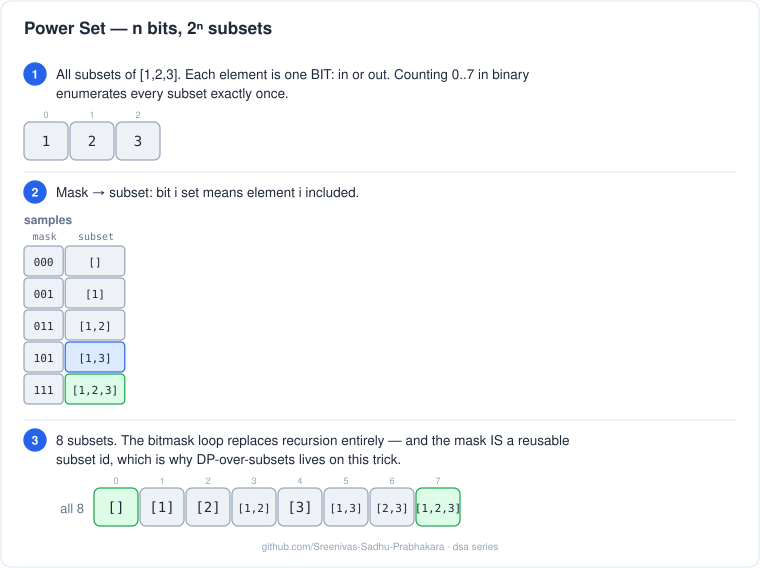

# Power Set

> Striver SDE Sheet 189 · Day 27 Trie — count from 0 to 2ⁿ−1 and read each number as a membership mask; the for-loop *is* the enumeration. Go, stdlib only, tested.

## Problem

All subsets of a set — generated via bit manipulation, which is why it sits in the closing (bit-leaning) section despite subsets appearing back on Day 9.

## Approach

A subset of n elements is an n-bit string: bit i says whether element i is in. The integers 0..2ⁿ−1 enumerate every such string, so iterating a counter and testing each bit generates every subset with no recursion and no state beyond the loop variable. Contrast with #050's backtracking: recursion wins when pruning or deduplication is needed mid-generation; the bitmask wins for raw enumeration and for *indexing* subsets (subset #13 is reproducible on demand — useful in bitmask DP, where masks are array indexes). Masks above 63 elements don't fit an int — not a practical concern, since 2⁶³ subsets aren't enumerable anyway.

**Complexity:** O(2ⁿ · n) time — the output's own size.

## Visual walkthrough

Read the picture top to bottom — each numbered frame is one moment of the algorithm
running on this repo's test example.

## Run

    go test ./...   # verify
    go run .        # demo

---

One of 191 repos solving Striver's SDE Sheet in Go — stdlib only, one problem per repo, every solution tested. Browse the set: [`dsa-*` repos](https://github.com/Sreenivas-Sadhu-Prabhakara?tab=repositories&q=dsa-&type=source).
